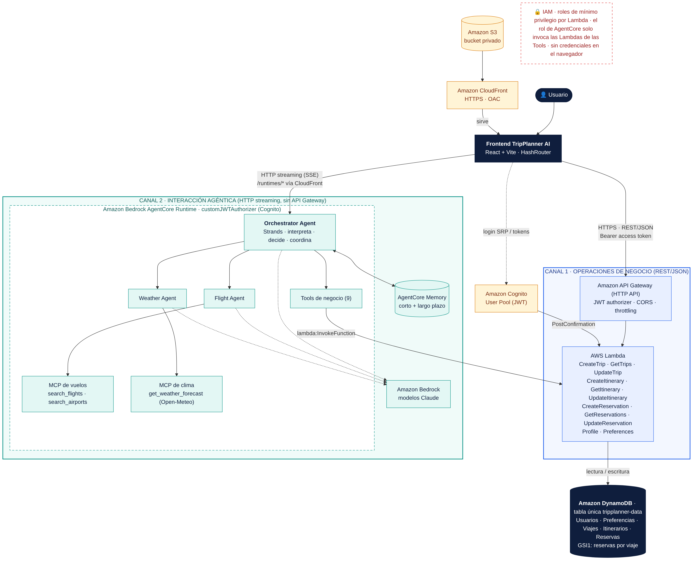

# TripPlanner AI ✈️ · Your AI Travel Companion

Este es el trabajo final de Programación Agéntica (Ingeniería de Sistemas). TripPlanner deja de ser una demo del Playground de AgentCore y pasa a ser una **aplicación web completa**: frontend React, arquitectura multiagente con **Strands Agents** sobre **Amazon Bedrock AgentCore**, MCP de vuelos y clima, y un backend serverless con **API Gateway + Lambda + DynamoDB**.



## Estructura del repositorio

```
tripplanner-ai/
├── backend/                 Canal 1 · AWS SAM (IaC)
│   ├── template.yaml        Cognito, HTTP API, 14 Lambdas, DynamoDB, S3, CloudFront, IAM
│   ├── src/common/          Adaptador HTTP/agente, validaciones y acceso a DynamoDB
│   ├── src/handlers/        trips · itineraries · reservations · users
│   └── tests/               pytest + moto (flujo completo, aislamiento, validaciones)
├── agent/                   Canal 2 · AgentCore Runtime
│   ├── main.py              Entrypoint con HTTP streaming (SSE) y eventos para la UI
│   ├── tripplanner/         Orchestrator, Flight/Weather Agents, Tools de negocio, memoria
│   ├── mcp_servers/         MCP de vuelos y MCP de clima (Open-Meteo)
│   └── scripts/             create_memory.py · deploy_agent.sh
├── frontend/                React + Vite · 6 módulos · Agent-Driven UI
├── scripts/windows/         Despliegue y diagnóstico en PowerShell (1-2-3, test-models, logs, diag)
├── scripts/deploy_frontend.sh
└── docs/                    Documentación técnica, despliegue, guion de la demo y diagrama
```

## Cumplimiento del enunciado

| Requisito | Dónde |
|---|---|
| Se conservan los 3 agentes (Orchestrator, Flight, Weather) | `agent/tripplanner/orchestrator.py`, `specialists.py` |
| HTTP streaming directo, sin API Gateway | `agent/main.py`, `frontend/src/api/agent.js`, comportamiento `/runtimes/*` en CloudFront |
| 6 módulos del frontend | Dashboard · Asistente · Vuelos · Clima · Mis viajes / itinerarios / preferencias · Reservas |
| Agent-Driven UI | Eventos `ui` → `frontend/src/components/AgentRenderer.jsx` |
| 8 Tools respaldadas por Lambda (+ preferencias) | `agent/tripplanner/business_tools.py` → `backend/src/handlers/*` |
| Persistencia en DynamoDB (usuarios, preferencias, viajes, itinerarios, reservas y estados) | `backend/src/common/db.py`, [modelo de datos](docs/DOCUMENTACION_TECNICA.md#2-modelo-de-datos) |
| Reservas simuladas con estados Simulada / Pendiente / Confirmada | `validation.py`, `reservations.py`, `StatusBadge` |
| Memoria (3 mecanismos) ≠ persistencia | `orchestrator.py`, `scripts/create_memory.py` |
| Seguridad (IAM mínimo, JWT, CORS, throttling, validación, sin tarjetas) | `template.yaml`, `validation.py`, [§7](docs/DOCUMENTACION_TECNICA.md#7-seguridad) |
| Frontend en S3 (+ CloudFront) | `template.yaml`, `scripts/deploy_frontend.sh` |
| Documentación, evidencias y demo | [`docs/`](docs) · [Evidencias](docs/EVIDENCIAS.md) |

## Inicio rápido

**Windows (PowerShell), el camino usado en el despliegue real:**

```powershell
Set-ExecutionPolicy -Scope Process Bypass
.\scripts\windows\1-deploy-backend.ps1
.\scripts\windows\2-deploy-agent.ps1 -CreateMemory
.\scripts\windows\3-deploy-frontend.ps1
```

**Linux / macOS:**

```bash
# 1. Backend
cd backend && sam build && sam deploy --guided
# 2. Agentes
cd ../agent && pip install -r requirements-dev.txt && ./scripts/deploy_agent.sh tripplanner-ai us-east-1
# 3. Frontend
cd .. && AGENT_RUNTIME_ARN=<arn> ./scripts/deploy_frontend.sh tripplanner-ai us-east-1
```

La guía completa está en [docs/DESPLIEGUE.md](docs/DESPLIEGUE.md).

Para probar solo la interfaz, sin AWS: `cd frontend && npm install && VITE_MOCK=true npm run dev`.

## Pruebas

```bash
cd backend  && pytest -q     # Lambdas + DynamoDB (moto)
cd agent    && pytest -q     # Tools→Lambdas, MCP de clima, protocolo de streaming
cd frontend && npm test      # parser SSE
```

## Cronograma de 15 días

| Días | Etapa | Entregables | Hito |
|---|---|---|---|
| 1–2 | Diseño y arquitectura | Wireframes, modelo DynamoDB, diseño de APIs, diagrama | Día 2 · Diseño aprobado |
| 3–5 | Backend y persistencia | Lambdas, API Gateway, plantilla SAM, pruebas | Día 5 · Backend operativo |
| 6–8 | Frontend | Dashboard, navegación, chat, pantallas de viajes, integración de APIs | Día 8 · Frontend navegable |
| 9–11 | Integración agéntica | AgentCore, Flight y Weather, nuevas Tools, eventos UI | Día 11 · Integración completa |
| 12–13 | Pruebas | Flujo completo, recuperación de datos, corrección de errores | — |
| 14–15 | Documentación y entrega | README, diagramas, evidencias, despliegue, sustentación | Día 15 · Entrega final |
