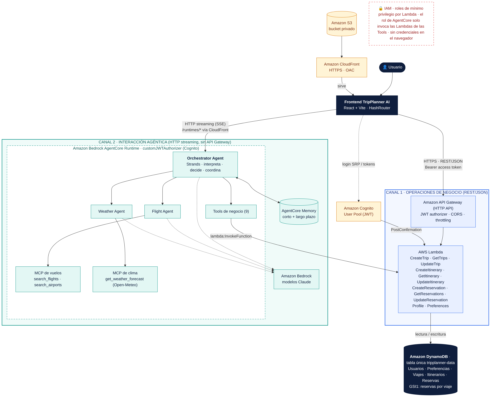

# TripPlanner AI · Documentación técnica

Trabajo final de Programación Agéntica. TripPlanner deja de usarse solo desde el Playground de AgentCore y se convierte en una aplicación web completa. Tiene un frontend propio, conserva la arquitectura de tres agentes (Orchestrator, Flight y Weather) y agrega un backend serverless con persistencia en DynamoDB.

**Contenido:**

1. [Arquitectura](#1-arquitectura)
2. [Modelo de datos](#2-modelo-de-datos)
3. [APIs](#3-apis)
4. [Lambdas](#4-lambdas)
5. [Tools](#5-tools)
6. [Integración de agentes](#6-integración-de-agentes)
7. [Seguridad](#7-seguridad)
8. [Instrucciones de ejecución](#8-instrucciones-de-ejecución)

---

## 1. Arquitectura



La fuente editable del diagrama está en `arquitectura.mmd`.

### Dos canales independientes

| Canal | Ruta | Uso |
|---|---|---|
| **1 · Operaciones de negocio** | Frontend → **API Gateway (HTTP API)** → **Lambda** → **DynamoDB** | Pantallas y formularios: crear, consultar y editar viajes, itinerarios, reservas y preferencias. |
| **2 · Interacción agéntica** | Frontend → **HTTP streaming (SSE)** → **AgentCore Runtime** → **Orchestrator** | Chat con el asistente. El Orchestrator delega en Flight Agent (MCP de vuelos), Weather Agent (MCP de clima) y en las Tools de negocio, que a su vez invocan las Lambdas. |

**El canal 2 no pasa por API Gateway.** El navegador llama al endpoint de streaming de AgentCore. La ruta `/runtimes/*` de la misma distribución CloudFront del frontend tiene como origen `bedrock-agentcore.<región>.amazonaws.com`.

- **Por qué CloudFront y no la llamada directa:** así el chat queda en el mismo dominio que la página. El navegador no tiene que negociar CORS y el stream pasa sin transformación, porque la caché está deshabilitada y el cuerpo no se comprime.
- **CloudFront no es un intermediario de negocio:** no autentica ni modifica la petición. El token del usuario lo valida el `customJWTAuthorizer` del propio runtime.
- **Llamada directa:** sigue disponible con `VITE_AGENT_MODE=direct` (ver §6).

### Componentes y responsabilidades

| Componente | Responsabilidad |
|---|---|
| **Frontend (React + Vite)** | Experiencia de usuario: 6 módulos y Agent-Driven UI. Publicado en S3 privado y servido por CloudFront con OAC. |
| **Amazon Cognito** | Registro, inicio de sesión (SRP) y emisión de JWT. El trigger `PostConfirmation` crea el perfil del usuario. |
| **AgentCore Runtime** | Ejecuta los agentes y expone `/invocations` con streaming. Valida el JWT de Cognito. |
| **Orchestrator Agent** | Interpreta la intención del usuario, decide qué especialista o Tool usar y redacta la respuesta. |
| **Flight Agent / Weather Agent** | Especialistas. Cada uno es un `Agent` de Strands con sus herramientas MCP. |
| **MCP de vuelos y MCP de clima** | Herramientas especializadas (servidores MCP stdio). Ver §6.3. |
| **AgentCore Memory** | Memoria de corto y largo plazo de la conversación. |
| **API Gateway (HTTP API)** | Expone las operaciones de negocio con autorizador JWT, CORS restringido, *throttling* y logs de acceso. |
| **AWS Lambda** | Lógica de negocio y validaciones. Hay una función por operación. |
| **DynamoDB** | Persistencia y fuente de verdad (tabla única con un índice GSI). |
| **S3 / CloudFront** | Hosting del frontend y CDN HTTPS. CloudFront además hace de puerta de mismo dominio hacia AgentCore. |
| **IAM** | Roles con mínimo privilegio: uno por Lambda y otro para AgentCore. |

### Principios de diseño aplicados

- **Los agentes deciden:**
  - El Orchestrator elige entre 2 especialistas y 9 Tools.
  - El `user_id` no lo decide el modelo: se toma del JWT y se fija en las Tools al construirlas.
- **Las Lambdas ejecutan:** validan tipos, rangos, fechas, estados y transiciones, y rechazan datos de pago.
- **DynamoDB almacena:** la memoria del agente no reemplaza la persistencia. Para "mis viajes" el agente siempre consulta `get_trips` y `get_reservations`.
- **API Gateway publica:** el frontend nunca accede a DynamoDB.

### Decisiones de diseño

| Decisión | Justificación |
|---|---|
| Una Lambda por operación | Cada función recibe permisos IAM mínimos. Por ejemplo, `GetTrips` solo puede hacer `GetItem` y `Query`. Además, la observabilidad queda separada por operación. |
| La misma Lambda sirve al API y a la Tool | No se duplica lógica. El adaptador `common/http.py` reconoce los eventos de API Gateway (usuario tomado de `claims.sub`) y las invocaciones del agente (`source: "agent"`). Solo el rol de AgentCore puede invocar directamente. |
| Agents-as-tools | El Orchestrator ve a Flight y Weather como Tools. Cada especialista mantiene su propio prompt, sus herramientas y su contexto aislado. |
| Agent-Driven UI por eventos | Los resultados estructurados de las herramientas se emiten como eventos `ui` en el mismo stream. El texto del modelo nunca se analiza para dibujar componentes. |
| MCP de vuelos simulado y determinista | No hay una API de vuelos gratuita y estable. Las ofertas se calculan con la distancia real entre aeropuertos, la antelación, el día de la semana y las aerolíneas de cada mercado. La UI marca la fuente como "simulada", y el diseño permite conectar un proveedor real. |
| MCP de clima real (Open-Meteo) | Gratuito y sin API key. Para fechas que superan el horizonte de 16 días devuelve una referencia histórica y lo indica. |
| HashRouter | Evita las reglas de error 403/404 → `index.html` en CloudFront, que de lo contrario ocultarían los errores reales de `/runtimes/*`. |

---

## 2. Modelo de datos

### Tabla única `tripplanner-data`

Se usa una sola tabla (single-table design) por tres razones:

- Todos los accesos son por usuario, y la partición `USER#<sub>` aísla los datos de cada uno.
- Basta una consulta para leer cualquier colección del usuario.
- Hay un solo recurso que asegurar y respaldar (con PITR y cifrado SSE habilitados).

| Entidad | PK | SK | GSI1PK / GSI1SK | Atributos principales |
|---|---|---|---|---|
| Usuario | `USER#<sub>` | `PROFILE` | — | userId, email, name, phone, country, language, createdAt |
| Preferencias | `USER#<sub>` | `PREFS` | — | activityTypes[], dietaryRestrictions[], accessibilityNeeds[], preferredAirlines[], budgetPerDay, currency, travelPace, seatPreference, homeCity, notes |
| Viaje | `USER#<sub>` | `TRIP#<tripId>` | — | tripId, title, origin, destination, startDate, endDate, travelers, budget, currency, interests[], status, notes, createdBy |
| Itinerario | `USER#<sub>` | `ITIN#<tripId>` | — | tripId, summary, days[{day, date, title, activities[{time, title, description, location, estimatedCost, category}]}], version |
| Reserva | `USER#<sub>` | `RES#<reservationId>` | `TRIP#<tripId>` / `RES#<createdAt>#<id>` | reservationId, tripId, tripDestination, type, title, provider, providerReference, startDateTime, endDateTime, amount, currency, quantity, status, statusHistory[], confirmationCode, details{} |

`createdBy` vale `api` o `agent` e indica por qué canal se creó el dato. Así se distingue en la demo qué hizo el agente.

### Estados

- **Viaje:** `PLANEADO`, `EN_CURSO`, `COMPLETADO` o `CANCELADO`.
- **Reserva:**

| Estado | Significado | Transiciones permitidas |
|---|---|---|
| `SIMULADA` | Registrada por el sistema sin proveedor externo. Es el estado por defecto. | → `PENDIENTE` |
| `PENDIENTE` | Registrada y a la espera de confirmación. | → `SIMULADA`, → `CONFIRMADA` |
| `CONFIRMADA` | Confirmada por un proveedor real. Exige `providerReference`. | (final) |

Cada cambio de estado queda registrado en `statusHistory`.

### Patrones de acceso

| # | Patrón | Operación |
|---|---|---|
| 1 | Perfil / preferencias del usuario | `GetItem PK=USER#sub, SK=PROFILE / PREFS` |
| 2 | Listar viajes del usuario | `Query PK=USER#sub, SK begins_with TRIP#` |
| 3 | Detalle de un viaje | `GetItem SK=TRIP#id` |
| 4 | Itinerario de un viaje | `GetItem SK=ITIN#tripId` |
| 5 | Listar reservas del usuario | `Query PK=USER#sub, SK begins_with RES#` |
| 6 | Reservas de un viaje | `Query GSI1 GSI1PK=TRIP#tripId` (ordenadas por fecha de creación) |
| 7 | Crear sin sobrescribir | `PutItem` con `attribute_not_exists(PK)` |
| 8 | Actualizar solo si existe y pertenece al usuario | `UpdateItem` con `attribute_exists(PK)` sobre la clave del usuario |

---

## 3. APIs

- **Base:** `https://<apiId>.execute-api.<región>.amazonaws.com/v1`
- **Autorización:** `Authorization: Bearer <access token de Cognito>` en todas las rutas.
- **Formato:** JSON en peticiones y respuestas.

| Método | Ruta | Lambda | Parámetros / cuerpo | Respuesta |
|---|---|---|---|---|
| GET | `/me` | GetProfile | — | `200 {profile}` |
| PUT | `/me` | UpdateProfile | `{name?, phone?, country?, language?}` | `200 {profile}` |
| GET | `/preferences` | GetPreferences | — | `200 {preferences}` |
| PUT | `/preferences` | SavePreferences | campos de preferencias (parcial) | `200 {preferences}` |
| POST | `/trips` | CreateTrip | `{origin, destination, startDate, endDate, travelers, budget?, currency?, title?, interests?, notes?}` | `201 {trip}` |
| GET | `/trips` | GetTrips | query `status?` | `200 {trips[], count}` |
| GET | `/trips/{tripId}` | GetTrips | — | `200 {trip, itinerary, reservations[]}` |
| PUT | `/trips/{tripId}` | UpdateTrip | campos del viaje (parcial) + `status?` | `200 {trip}` |
| POST | `/trips/{tripId}/itinerary` | CreateItinerary | `{days[], summary?}` | `201 {itinerary}` |
| GET | `/trips/{tripId}/itinerary` | GetItinerary | — | `200 {itinerary}` |
| PUT | `/trips/{tripId}/itinerary` | UpdateItinerary | `{days[], summary?}` (reemplazo completo) | `200 {itinerary}` (version+1) |
| POST | `/reservations` | CreateReservation | `{tripId, type, title, provider?, startDateTime?, endDateTime?, amount?, currency?, quantity?, status?, details?, notes?}` | `201 {reservation}` |
| GET | `/reservations` | GetReservations | query `tripId?, status?, type?` | `200 {reservations[], count}` |
| GET | `/reservations/{reservationId}` | GetReservations | — | `200 {reservation}` |
| PUT | `/reservations/{reservationId}` | UpdateReservation | `{status?, title?, amount?, ..., tripId?}` (`tripId` reasocia la reserva a otro viaje) | `200 {reservation}` |

### Errores

Todos los errores tienen la misma forma:

```json
{ "error": { "code": "VALIDATION_ERROR", "message": "Hay datos inválidos en la petición.",
             "details": [{ "field": "endDate", "message": "La fecha de regreso debe ser posterior..." }] } }
```

| HTTP | Códigos |
|---|---|
| 400 | `VALIDATION_ERROR`, `INVALID_JSON`, `EMPTY_UPDATE`, `PAYMENT_DATA_FORBIDDEN` |
| 401 | `UNAUTHORIZED`: token ausente o inválido. Lo rechaza el autorizador JWT antes de llegar a la Lambda. |
| 404 | `TRIP_NOT_FOUND`, `ITINERARY_NOT_FOUND`, `RESERVATION_NOT_FOUND`. Un recurso de otro usuario también responde 404, para no revelar que existe. |
| 409 | `ALREADY_EXISTS`, `INVALID_STATUS_TRANSITION`, `CONFIRMATION_REQUIRES_PROVIDER` |
| 429 | *Throttling* de API Gateway |
| 500 | `INTERNAL_ERROR` con `requestId`. El detalle va a CloudWatch y nunca se expone al usuario. |

---

## 4. Lambdas

| Lambda | Handler | Función | Validaciones clave | Permisos IAM (tabla / índice) |
|---|---|---|---|---|
| CreateTrip | `handlers.trips.create_trip` | Crea un viaje (estado `PLANEADO`) | Campos obligatorios; fechas ISO no pasadas y ≤ 2 años; `end ≥ start` y ≤ 60 días; viajeros 1–20; presupuesto ≥ 0; moneda ∈ {COP, USD, EUR} | `PutItem` |
| GetTrips | `handlers.trips.get_trips` | Lista viajes o devuelve el detalle con itinerario y reservas | `tripId` válido y del usuario | `GetItem`, `Query` (+GSI1) |
| UpdateTrip | `handlers.trips.update_trip` | Actualización parcial | Mismas reglas que al crear + `status` permitido + coherencia con las fechas actuales | `GetItem`, `UpdateItem` |
| CreateItinerary | `handlers.itineraries.create_itinerary` | Crea el itinerario de un viaje | 1–60 días sin repetir; fechas dentro del viaje; ≤ 20 actividades por día; hora HH:MM; costos ≥ 0. Devuelve 409 si ya existe. | `GetItem`, `PutItem` |
| GetItinerary | `handlers.itineraries.get_itinerary` | Consulta el itinerario | El viaje debe pertenecer al usuario | `GetItem` |
| UpdateItinerary | `handlers.itineraries.update_itinerary` | Reemplaza el itinerario e incrementa `version` | Igual que al crear | `GetItem`, `UpdateItem` |
| CreateReservation | `handlers.reservations.create_reservation` | Registra una reserva asociada a un viaje | `type` ∈ {FLIGHT, HOTEL, ACTIVITY}; `status` por defecto `SIMULADA`; `CONFIRMADA` exige proveedor; sin datos de pago | `GetItem`, `PutItem` |
| GetReservations | `handlers.reservations.get_reservations` | Lista o detalle, con filtros por viaje, estado o tipo | Pertenencia al usuario | `GetItem`, `Query` (+GSI1) |
| UpdateReservation | `handlers.reservations.update_reservation` | Actualiza datos, estado o viaje asociado | Transiciones permitidas; registra `statusHistory` | `GetItem`, `UpdateItem` |
| GetProfile / UpdateProfile | `handlers.users.*` | Perfil del usuario | Longitudes; idioma ∈ {ES, EN} | `GetItem`, `PutItem` (+`UpdateItem`) |
| GetPreferences / SavePreferences | `handlers.users.*` | Preferencias de viaje | Listas ≤ 20 elementos; enumeraciones | `GetItem` (+`PutItem`) |
| PostConfirmation | `handlers.users.post_confirmation` | Trigger de Cognito que crea el perfil | Nunca bloquea el registro | `GetItem`, `PutItem` |

**Comunes a todas las Lambdas:**

- Python 3.12 sobre arm64.
- Trazas de X-Ray y logs en formato JSON.
- `reject_payment_data()` recorre todo el cuerpo y rechaza:
  - llaves como `card`, `cvv` o `tarjeta`;
  - números de tarjeta válidos según el algoritmo de Luhn, aunque aparezcan dentro de un texto.

Las Lambdas tienen pruebas automáticas en `backend/tests` (7 casos con DynamoDB simulado mediante moto). Cubren el flujo completo de la demo, el aislamiento entre usuarios, las validaciones, los datos de pago y los estados.

---

## 5. Tools

Las Tools están definidas en `agent/tripplanner/business_tools.py`. Cada una invoca su Lambda con el evento `{"source":"agent","userId":<sub del JWT>, "pathParameters", "queryStringParameters", "body"}`.

| Tool (Strands) | Tool del enunciado | Parámetros | Lambda que la respalda | Componente UI emitido |
|---|---|---|---|---|
| `create_trip` | **CreateTrip** | origin, destination, start_date, end_date, travelers, budget?, currency?, title?, interests?, notes? | `tripplanner-CreateTrip` | `trip` |
| `get_trips` | **GetTrips** | trip_id?, status? | `tripplanner-GetTrips` | `trips` / `trip_detail` |
| `update_trip` | **UpdateTrip** | trip_id + campos opcionales | `tripplanner-UpdateTrip` | `trip` |
| `create_itinerary` | **CreateItinerary** | trip_id, days[], summary? | `tripplanner-CreateItinerary` | `itinerary` |
| `update_itinerary` | **UpdateItinerary** | trip_id, days[], summary? | `tripplanner-UpdateItinerary` | `itinerary` |
| `create_reservation` | **CreateReservation** | trip_id, type, title, provider?, start_datetime?, end_datetime?, amount?, currency?, quantity?, status?, details? | `tripplanner-CreateReservation` | `reservation` |
| `get_reservations` | **GetReservations** | trip_id?, status?, type? | `tripplanner-GetReservations` | `reservations` |
| `update_reservation` | **UpdateReservation** | reservation_id, status?, title?, amount?, ..., trip_id? | `tripplanner-UpdateReservation` | `reservation` |
| `save_preferences` | *(adicional)* | activity_types?, dietary_restrictions?, budget_per_day?, travel_pace?, ... | `tripplanner-SavePreferences` | `preferences` |
| `flight_specialist` | → Flight Agent | request (texto) | MCP de vuelos | `flights` |
| `weather_specialist` | → Weather Agent | request (texto) | MCP de clima | `weather` |

**Ciclo de una Tool** (Figura 2 del enunciado): el usuario escribe "Crea mi viaje" → el Orchestrator decide usar `create_trip` → la Tool hace `lambda.invoke` → la Lambda valida y escribe en DynamoDB → el resultado (`tripId`, estado) vuelve al agente → el frontend recibe el evento `ui:trip` y dibuja la tarjeta.

Si la Lambda devuelve un error (4xx), la Tool responde `{"ok": false, ...}` en lugar de lanzar una excepción. Así el agente puede explicar el problema o corregir los datos.

---

## 6. Integración de agentes

### 6.1 HTTP streaming desde el frontend

`frontend/src/api/agent.js` hace la llamada:

```
POST {origen}/runtimes/{ARN URL-encoded}/invocations?qualifier=DEFAULT
Authorization: Bearer <access token Cognito>
X-Amzn-Bedrock-AgentCore-Runtime-Session-Id: tp-<uuid>-<timestamp>   (≥ 33 caracteres)
Content-Type: application/json
{"prompt": "Quiero organizar unas vacaciones..."}
```

- **Lectura del stream:** la respuesta llega como `text/event-stream` y se lee con `fetch` + `ReadableStream`.
- **Parseo:** lo hace `parseSSEChunk`, que tiene pruebas en `src/agent.test.js`.
- **Sesión:** el `sessionId` se guarda por usuario. Al cerrar y volver a abrir la app se continúa la misma sesión, y con ella la memoria de corto plazo.
- **Tipos de evento** que emite `agent/main.py`:

| Evento | Uso en la UI |
|---|---|
| `{"type":"start","sessionId"}` | Inicio de la respuesta |
| `{"type":"status","agent","message"}` | Indicadores de procesamiento (p. ej. "Flight Agent · Consultando vuelos…") |
| `{"type":"text","delta"}` | Texto en streaming, renderizado como Markdown |
| `{"type":"ui","component","data"}` | **Agent-Driven UI**: `flights` → tarjetas comparativas, `weather` → tarjetas por día, `itinerary` → agenda, `trip(s)` → tarjetas de viaje, `reservation(s)` → listado con estados |
| `{"type":"error","message"}` / `{"type":"done"}` | Manejo de errores y fin |

`VITE_AGENT_MODE` indica cómo llega el navegador al runtime:

- `cloudfront` (recomendado): mismo dominio que la página, sin CORS.
- `direct`: `bedrock-agentcore.<región>.amazonaws.com`.
- `local`: `python agent/main.py` en el puerto 8080.

### 6.2 Identidad del usuario en el agente

1. AgentCore valida el JWT con `customJWTAuthorizer`, que apunta al discovery URL de Cognito y acepta el `client_id` de la app.
2. El runtime reenvía el header `Authorization`, configurado con `--request-header-allowlist Authorization`.
3. `resolve_user()` toma el claim `sub`.
4. Las Tools se construyen por petición con ese `user_id` (closure). El modelo nunca puede leer ni escribir datos de otro usuario.

### 6.3 MCP

Flight y Weather son servidores MCP stdio (`agent/mcp_servers/`). Los inicia el contenedor una sola vez mediante `MCPClient` de Strands, y cada especialista recibe sus herramientas con `list_tools_sync()`.

| MCP | Herramientas | Fuente |
|---|---|---|
| Vuelos | `search_flights(origin, destination, departure_date, return_date, passengers, max_results)` y `search_airports(query)` | Generador determinista y realista (marcado como `simulated: true`). Para usar un proveedor real, reemplaza `_offers_for_leg` por una llamada a la API del proveedor, manteniendo el mismo JSON de salida. |
| Clima | `get_weather_forecast(city, start_date, end_date)` | Open-Meteo: pronóstico hasta 16 días y, para fechas más lejanas, referencia histórica del año anterior |

Si en el taller ya tenías tus propios MCP, solo cambia los `StdioServerParameters` en `specialists.py` (o usa `streamablehttp_client` si son remotos) y el nombre de la herramienta en `extract_tool_results`.

### 6.4 Memoria (tres mecanismos)

1. **Ventana de contexto:** `SlidingWindowConversationManager(window_size=40)`.
2. **Memoria de corto plazo de AgentCore:** guarda los eventos de la conversación por `actor_id` (sub) y `session_id`, mediante `AgentCoreMemorySessionManager`.
3. **Memoria de largo plazo de AgentCore:** usa tres estrategias, cada una en su *namespace*:
   - `userPreference` → `/users/{actorId}/preferences`
   - `semantic` → `/users/{actorId}/facts`
   - `summary` → `/summaries/{actorId}/{sessionId}`

   Se crean con `agent/scripts/create_memory.py`.

Además, las preferencias guardadas en DynamoDB se inyectan en el prompt del Orchestrator al inicio de cada turno. La memoria ayuda al agente a conversar mejor; DynamoDB sigue siendo la fuente de verdad.

---

## 7. Seguridad

| Requisito | Implementación |
|---|---|
| IAM con mínimo privilegio | Cada Lambda tiene su propia política con solo las acciones que usa sobre la tabla o el índice. El rol de AgentCore solo recibe `lambda:InvokeFunction` sobre las 10 Lambdas de las Tools (`AgentToolsInvokePolicy`), sin acceso a DynamoDB. |
| Sin credenciales en el frontend | El navegador solo maneja tokens de Cognito del usuario: cliente público sin secreto y flujo SRP. No hay claves de AWS. |
| Validación en Lambda | `common/validation.py`: tipos, rangos, fechas, enumeraciones, transiciones de estado y tamaños. |
| Control de acceso por usuario | La PK es siempre `USER#<sub del JWT>`. Un recurso ajeno responde 404. Hay pruebas automáticas que lo verifican. |
| Protección de APIs | Autorizador JWT en todas las rutas. CORS limitado al dominio de CloudFront y a `localhost:5173`. *Throttling* configurable (20 rps / ráfaga 40). Logs de acceso. |
| Manejo de errores | Códigos HTTP correctos, mensajes en español y `requestId` sin trazas internas. |
| Prohibido almacenar tarjetas | Las Lambdas rechazan los datos de pago (`PAYMENT_DATA_FORBIDDEN`). La UI no tiene campos de pago. El prompt prohíbe pedirlos. |
| Otros | S3 privado con OAC; HTTPS forzado; `SecurityHeadersPolicy` de CloudFront; DynamoDB cifrada con PITR; *timeout* y longitud máxima del prompt en el agente. |

---

## 8. Instrucciones de ejecución

Ver [DESPLIEGUE.md](DESPLIEGUE.md) (desde cero) y [DEMO.md](DEMO.md) (guion del escenario obligatorio).
