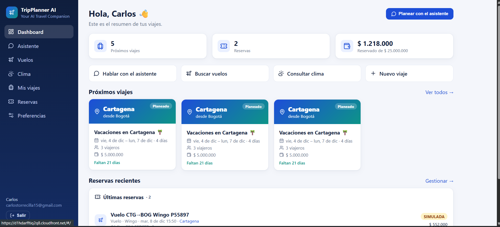
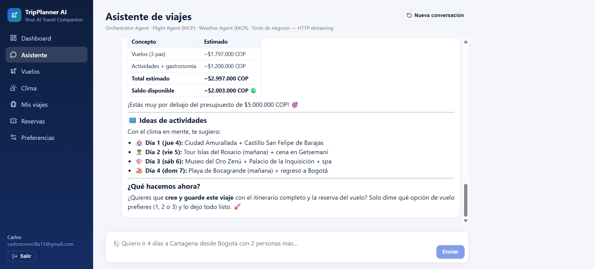
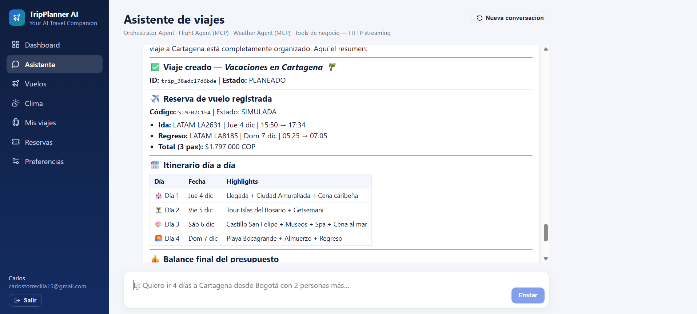
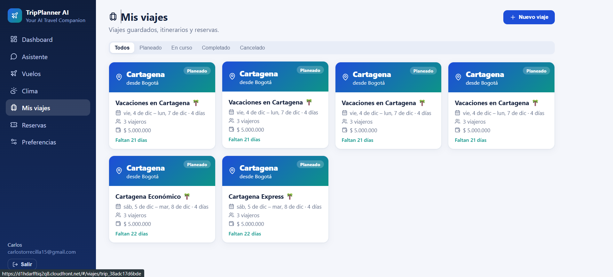
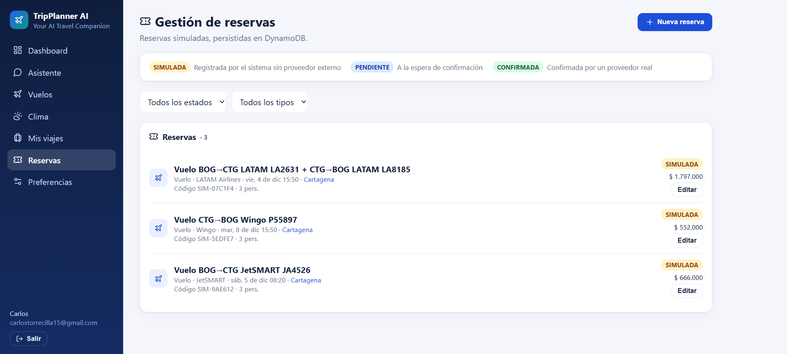
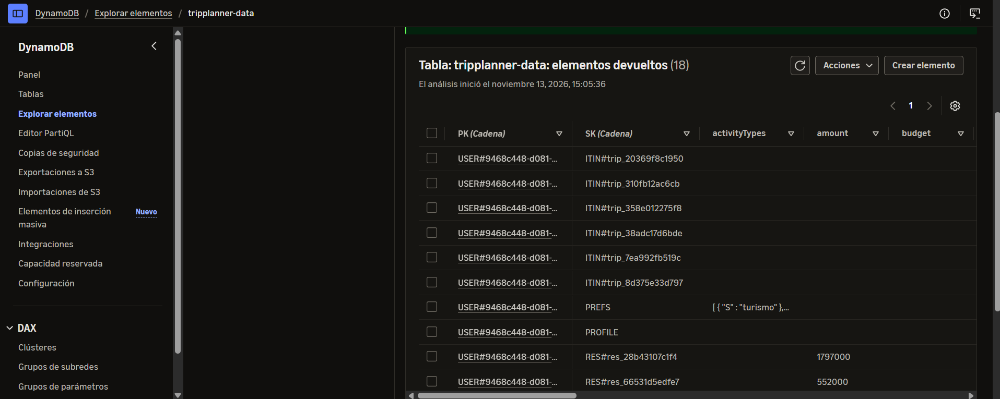

# Evidencias del despliegue

Capturas de la aplicación desplegada en AWS (`https://d1hdarfftiq2q8.cloudfront.net`, región `us-east-1`) durante la ejecución del escenario obligatorio de la sección 9 del enunciado.

## 1. Dashboard

Resumen del usuario autenticado: próximos viajes, reservas recientes y accesos rápidos.

## 2. Asistente: vuelos y clima (pasos 2 a 6)

El Orchestrator delega en Flight Agent (MCP de vuelos) y Weather Agent (MCP de clima). En la captura se ve el final de la respuesta, que llega por HTTP streaming: el control de presupuesto frente a los 5 millones de pesos (tabla), las actividades sugeridas según el clima y la propuesta del siguiente paso. Más arriba en la misma respuesta aparecen las tarjetas comparativas de vuelos y las tarjetas de clima por día (Agent-Driven UI).

## 3. Asistente: creación del viaje, itinerario y reserva (pasos 7 a 9)

El agente usa las Tools CreateTrip, CreateItinerary y CreateReservation, cada una respaldada por su Lambda. Devuelve el `tripId` real, el código de la reserva simulada (`SIM-…`) y el resumen del itinerario.

## 4. Mis viajes (paso 12)

Viajes recuperados desde DynamoDB (canal 1: API Gateway → Lambda GetTrips) después de cerrar sesión y volver a ingresar, con destino, fechas, viajeros y presupuesto.

## 5. Gestión de reservas

Listado con estados (Simulada, Pendiente, Confirmada), filtros y edición.

## 6. Persistencia en DynamoDB (paso 10)

Ítems `ITIN#`, `PREFS`, `PROFILE` y `RES#` (y `TRIP#` más abajo en la misma tabla) bajo la partición `USER#` del usuario, en la tabla `tripplanner-data`.

